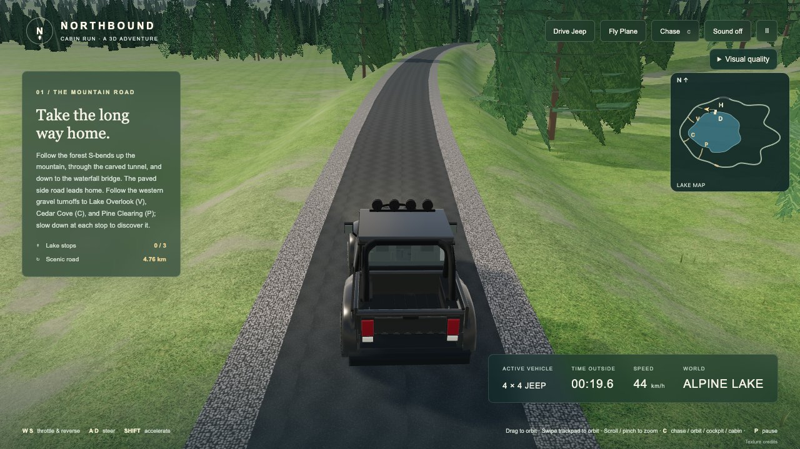
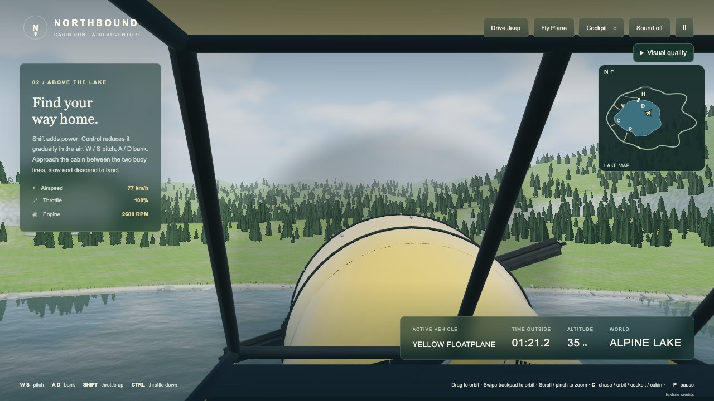

# Northbound · Cabin Run 3D

A real-time Three.js alpine-lake driving and floatplane sandbox, rebuilt from the supplied cabin artwork. Cabin, dock, jeep, floatplane and moving aircraft controls are actual Blender meshes. The supplied reference images are not redistributed.

Work stays on `feat/3d-alpine-lake`. `main` is unchanged, the old prototype is preserved in `legacy-2d/`, and nothing has been deployed.


## Gameplay gallery

Actual browser gameplay stills captured on November 6, 2026. These show the work-in-progress 3D build, not reference artwork or offline Blender renders.



*Pickup driving along the forested lake road.*



*Floatplane cockpit above the alpine lake.*


## Play locally

Use a current browser with WebGL 2 and hardware acceleration. All runtime assets and Three.js are local; no package installation or build is needed to play.

```sh
python3 -m http.server 4173
# Open http://localhost:4173
```

`npm start` runs the same server. Do not open the page through `file://`.

## Controls

- Choose **Drive Jeep** or **Fly Plane** in the top bar. The Jeep starts in the cabin parking bay facing the access aisle. V still switches vehicles.
- Jeep: W/S or arrows accelerate/reverse; A/D steer; Control brakes. Normal top speed is 79 km/h, or 101 km/h with Shift. Steering, lateral grip and four-wheel suspension are smoothed. Slow for corners.
- Plane: press Space to start the engine and wait three seconds. Hold Shift to increase throttle, then W to lift off above 36 km/h. Releasing Shift holds power. W/S changes pitch; A/D banks and steers. The actual ailerons, elevators and rudder move.
- Plane pushback: at idle on the water, hold B (or touch PUSH BACK) to push backward at walking pace. Release to slow, Control to stop. It cannot reverse in flight or while moored.
- Plane Control: reduces power in the air. On the water it also brakes the taxi motion. The HUD distinguishes these functions and shows throttle, airspeed and RPM.
- Landing: approach the cabin between the two buoy lines, reduce power and descend. Touchdown is physical water contact with flare/settling, paired expanding foam rings and a bounded spray burst, not a teleport. Taxi slowly to the extended pier; Space moors within 10 m at under 11 km/h. Space releases the mooring, then another Space starts the engine.
- V switches vehicle starting points. This remains a quick scene selector, not an on-foot boarding sequence.
- The north-up minimap shows the actual shore, winding road, bridge/tunnel, cabin/dock, your vehicle and heading.
- C cycles Chase → Orbit → Cockpit → Cabin. Cockpit views use vehicle-local anchors and lock orbit/zoom. Drag to orbit, scroll/pinch to zoom. Horizontal or diagonal trackpad swipes orbit; Shift+scroll is an explicit fallback. The camera ducks inside the tunnel and restores preferred zoom outside.
- P/Escape pauses. Losing focus pauses and clears held controls. Touch driving buttons, one-finger orbit and two-finger pinch are supported.
- Sound is opt-in. No accounts, analytics, tracking or gameplay network calls.

The **Visual quality** menu offers Fast, Balanced (default) and Photo presets plus a surface-texture toggle. First-time changes may need shader preparation; no preset guarantees a particular frame rate.

## The valley

The lake occupies a roughly 936 ×684 m basin, with irregular bays and wooded headlands. Its cabin cove, floatplane corridor and southern tributary mouth remain open. Cabin, vehicles, human doors, dock and parking retain real-world scale. The approximately 4.79 km road passes through a 70 m carved tunnel with three lake-view openings, climbs a 220 m forested shoulder through nine alternating S-bends, then descends to a granite bridge above the far-side tributary. The waterfall drops from a wooded 58 m head into the channel beneath the bridge. The tunnel roof joins the uphill bedrock instead of sitting apart from it.

Asphalt is 8.4 m wide. The cabin approach uses the same paving, clipped at the junction to avoid stacked surfaces. Distinct textured gravel shoulders and parking produce speed-dependent tyre dust. The driveway has metre-spaced geometry and is checked against the actual land mesh. Three perpendicular parking bays face a straight access aisle on a level forecourt and serve the enlarged timber cabin, with its balcony, wraparound glazing and furnished interior.

The cabin turnoff has a 12 m paved mouth tapering to 4.5 m over 32 m, with matched shoulders and an opening in the road-edge stripe. Three gravel spurs lead to **Lake Overlook**, **Cedar Cove** and **Pine Clearing**, with turnarounds, signs and a session discovery counter. Slow below 3 m/s inside each turnaround to discover it. See [lake exploration](docs/lake-exploration.md).

The pier extends to Z 36 with a verified floatplane berth. Float clearance, wing clearance and water immersion have been checked against the exported model. Taxi collision prevents passing through the pier.

A translucent flight edge and eight-second return countdown permit manual recovery before gentle steering assistance. The flight ceiling is 1,400 m, above the roughly 890 m snow-covered summit behind the tunnel. There are no rings, crates, races or imposed objectives.

## Visuals and performance

The photographed skyline has been removed. A building-free procedural sky and actual mountain terrain form the horizon. Sun, sky, fog, water highlights and indirect reflections follow one smooth ten-minute daylight/golden-hour cycle. The sun never falls below 11 degrees and the scene never enters night.

Terrain mixes grass, soil, wet/dry shoreline and granite detail. Adaptive terrain density and separately culled tiles keep detail where it matters. The 9,500 seeded trees use spatial chunks, detailed-to-card transitions at 160–220 m, mipmaps, atmospheric perspective and long-distance fade/culling. Reflections and shadows retain their own frustum culling.

This is an evolving playable reconstruction, not a claim of photorealistic parity with the reference. Close foliage still visibly uses crossed cards. Desktop spot checks are recorded below; mobile performance and a complete manual lake loop remain unverified.

## Rebuild and verify

```sh
npm install
npm test
node scripts/inspect-scene.mjs
blender --background --threads 4 --python scripts/build_scene.py
```

Blender 4.3+ recreates the editable `.blend` and `.glb`. Tests cover input-driven trips, startup/takeoff/landing, lane following at speed, frame-rate consistency, camera gestures, tunnel clearance/windows, actual road/land alignment, LOD, lighting and particles.

`?qa=1` enables `window.cabinQA`. `window.cabinDiagnostics()` reports recent real browser frame intervals, renderer counts and forest/terrain statistics. CPU submission estimates are not measured FPS.

Three.js 0.183.2 is MIT-licensed, see `vendor/THREE-LICENSE`. Texture attribution is in `assets/pbr/SOURCES.md` and linked from the game.

## Verification and limits

The [source integration audit](docs/source-integration-audit.md) records **165 passing tests**, syntax/diff checks and Chrome inspection for gameplay commit `f2927f7`. Both models, the HUD, widened cabin turnoff and Balanced quality were present with no captured console errors. This README refresh does not represent a new test run.

The [combined integration record](docs/combined-integration-2026-11-06.md) covers pickup/tire/seaplane refinements, river/cascade work and startup exhaust. [Cockpit integration](COCKPIT-INTEGRATION.md) records both seats, camera switching and an input-driven takeoff/banked turn. Cockpit instruments and head-look are not implemented; full manual landing remains outstanding.

A complete manual loop, physical mobile testing and matched performance benchmarks of the latest combined build remain outstanding. CPU submission estimates and short browser samples are not GPU timing or a sustained FPS guarantee.

The unavailable, previously unpushed MacBook commit `e2b5181` was not patch-audited and is not claimed integrated. All other completed sources covered by the recorded audit are reconciled; later unsaved or unpushed work cannot be verified from GitHub.

## Later milestones

Final gameplay trailers and the retrospective article remain deferred until the user is satisfied.

For later genuine browser capture, install Playwright separately, start the static server and run `node scripts/record-gameplay.mjs` on a WebGL-capable desktop. It records actual frames driven by scripted controls and saves unedited WebM/screenshots. This helper has not been GPU-verified in the cloud. No Blender or generated frame is substituted for gameplay.

